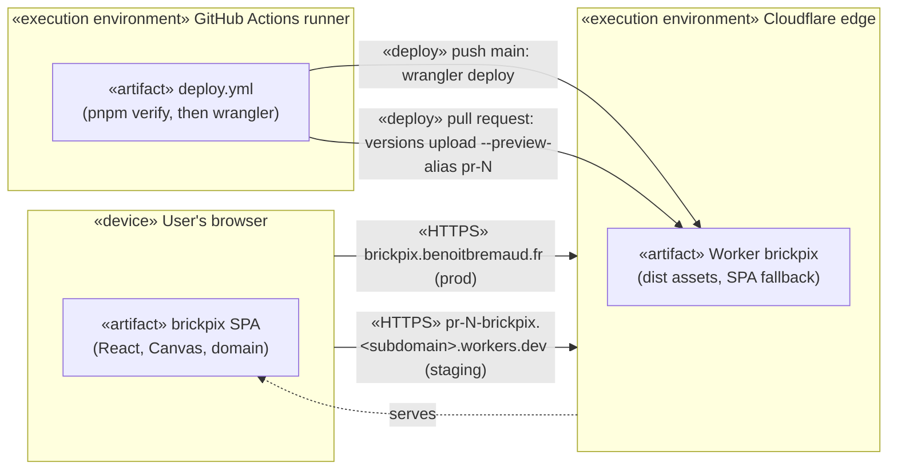

# dpl brickpix

## Context

Where brickpix runs and how a change reaches it. The app is static: one Cloudflare Worker serves the
built `dist` folder as assets, with no Worker script. The photo never leaves the browser, so the only
traffic is the download of the app itself. Validated by the owner on 2026-10-28 (issue #11).

## Diagram

Mermaid has no UML deployment notation: nodes are subgraphs, artifacts are boxes inside them, and
communication paths are labelled edges.

## Notes

- `wrangler.jsonc` declares the custom domain (`routes`, `custom_domain: true`): on `wrangler deploy`
  Cloudflare creates the DNS record and the certificate in the `benoitbremaud.fr` zone.
- `workers_dev: false`: production is no longer served on `brickpix.<subdomain>.workers.dev`; old links
  to that URL stop working at the first deploy. `preview_urls: true` is a separate setting, so
  pull-request previews stay on workers.dev. They are public, accepted: static app, public repo, no data.
- `versions upload` does not apply routes, so previews need no zone permission. The production deploy
  does: the CI token has Workers Scripts Edit plus, on `benoitbremaud.fr` only, Zone Read and Workers
  Routes Edit; it is scoped to this account and has an expiry.
- Tiers: `staging` = the pull-request preview, `prod` = the custom domain. No `qa` tier.
