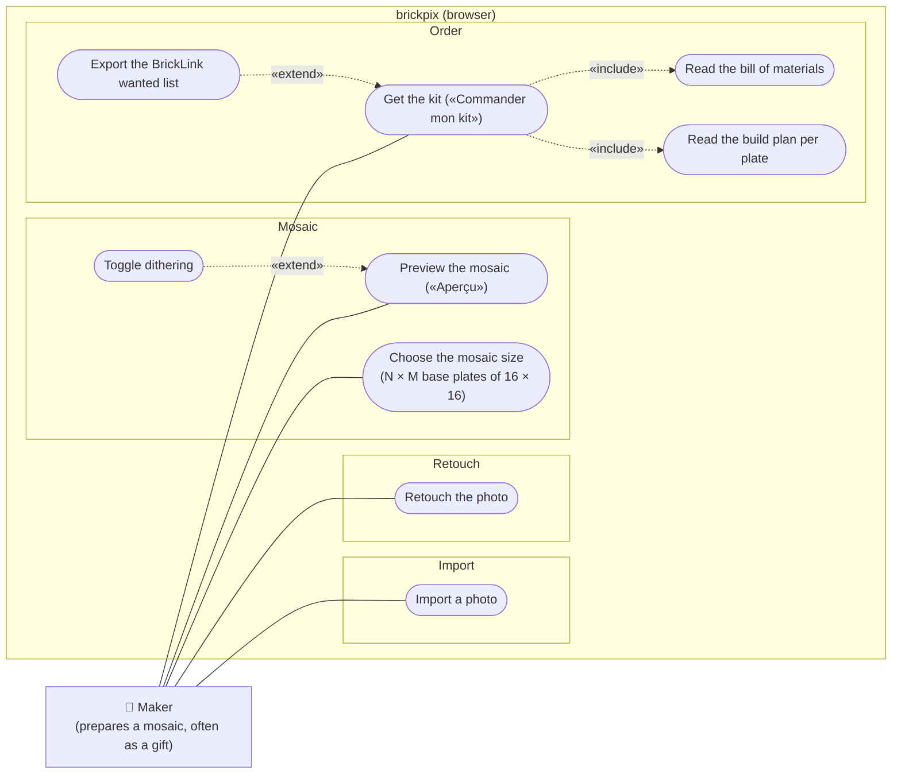

# uc Photo to mosaic

## Context

Which goals does the user initiate, from a photo to a kit they can order and build? One actor: the
person who makes the mosaic, usually as a gift. Everything runs in the browser; BrickLink and the
LEGO store are not actors of the system, the user takes the exported list there themself.

## Diagram

## Notes

- **Import**: file picker or drag and drop. The photo never leaves the browser.
- **Choose the mosaic size**: width and height are whole numbers ≥ 1 of 16 × 16 base plates (3 × 3
  is the LEGO Art standard 48 × 48; 4 × 4, 6 × 4 and larger for giant mosaics). Default 3 × 3. The
  size sets the crop ratio, so changing it re-fits the crop.
- **Retouch the photo**, optional and repeatable, is the differentiator against prior art. Its
  tools ([retouch.md](../../specs/retouch.md)): «Cadrer» (crop with the ratio locked to the size,
  quarter turn, mirror, and the size itself), «Ambiance» (Auto, moods, brightness, contrast,
  saturation, sharpen, dithering) and «Fond» (background simplification). Few controls at rest;
  a tap reveals only the options of its tool.
- **Preview** quantises the retouched photo to the palette of 1 × 1 round tiles and renders it. It
  is live: every size, retouch or dithering change refreshes it (debounced).
- **Get the kit** always gives the build plan split per plate (numbered 16 × 16 grid with a colour
  legend; a giant mosaic is built one plate at a time) and the bill of materials (tiles per colour,
  base plates); the BrickLink wanted list (XML) is an optional export.
- UI labels stay French («Aperçu», «Commander mon kit»); the user orders elsewhere, the tool only
  prepares the list.
- Out of scope for V1 (owner, 2026-10-23): accounts, server-side projects, automatic purchase, parts
  other than 1 × 1 round tiles, cost estimate (needs a price source), optional frame.
