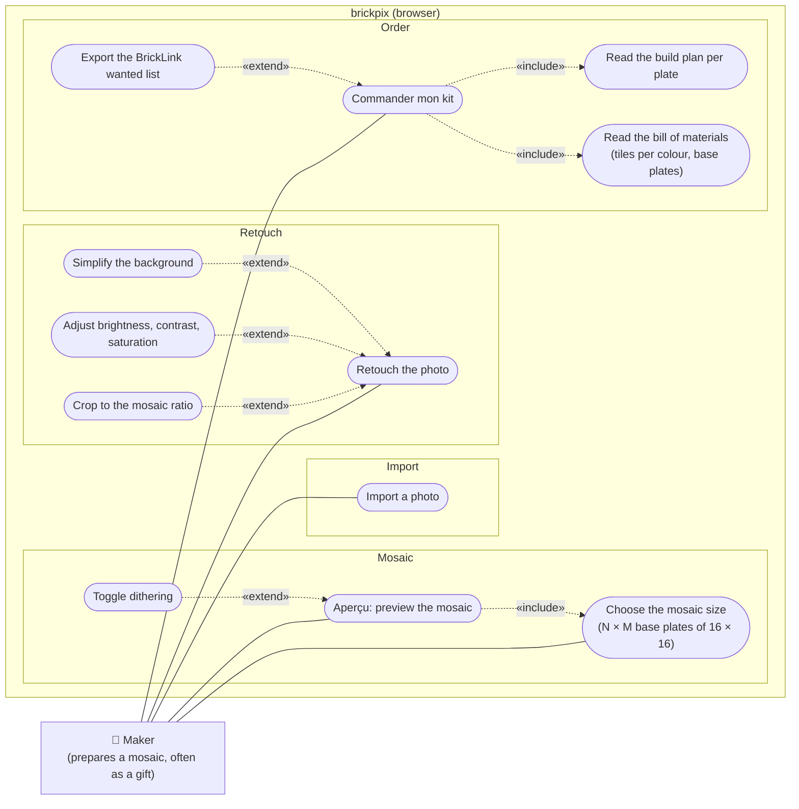

# uc Photo to mosaic

## Context

Which goals does the user initiate, from a photo to a kit they can order and build? One actor: the
person who makes the mosaic, usually as a gift. Everything runs in the browser; BrickLink and the
LEGO store are not actors of the system, the user takes the exported list there themself.

## Diagram

## Notes

- **Import**: file picker or drag and drop. The photo never leaves the browser.
- **Retouch** is optional and repeatable; each extension is one adjustment. It is the
  differentiator against prior art.
- **Choose the mosaic size**: width and height are whole numbers of 16 × 16 base plates (3 × 3 is
  the LEGO Art standard 48 × 48; 4 × 4, 6 × 4 and larger for giant mosaics). Included by Aperçu
  because a preview always has a size (default 3 × 3).
- **Aperçu** quantises the retouched photo to the palette of 1 × 1 round tiles and renders it.
- **Commander mon kit** always gives the build plan split per plate (a giant mosaic is built one
  plate at a time) and the bill of materials, base plates included; the BrickLink wanted list
  (XML) is an optional export.
- Out of scope for V1: accounts, server-side projects, automatic purchase, parts other than
  1 × 1 round tiles, cost estimate (needs a price source, later brick).
