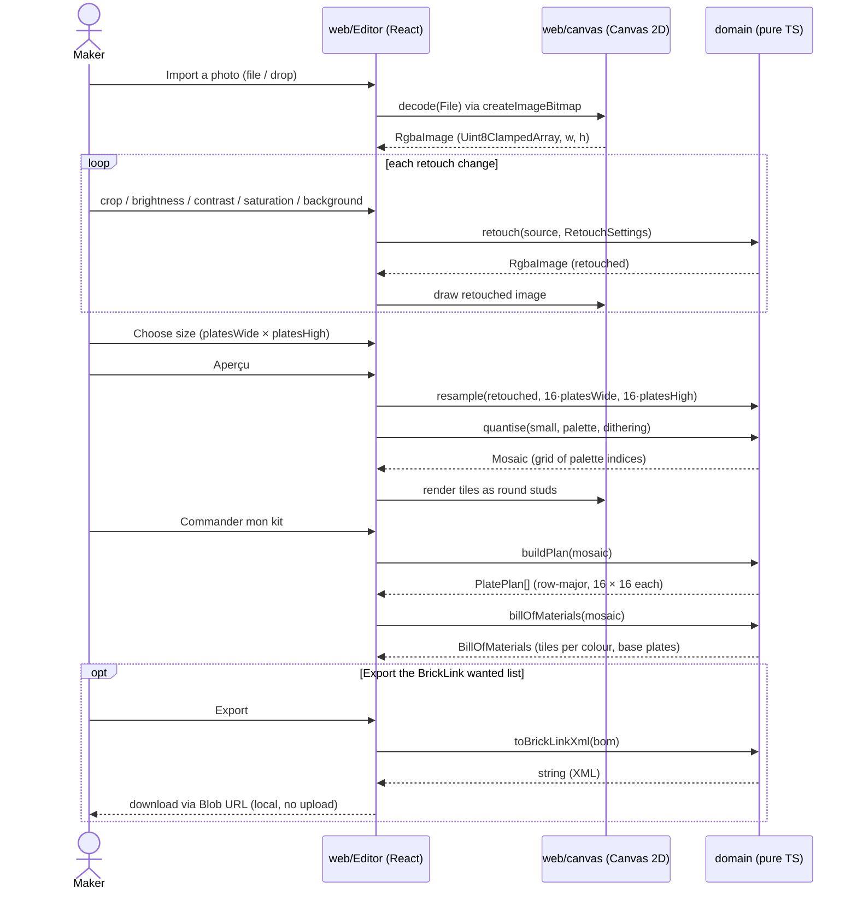

# sd Photo to kit

## Context

How a photo flows from import to the kit, across the web layer and the pure domain. Main success
scenario of the use cases in `01-use-case.md`.

## Diagram

## Notes

- Decoding and drawing are the only Canvas steps; every computation is a pure domain function over
  typed arrays, so it is unit-testable without a DOM.
- Retouch always restarts from the decoded source, never from the previous result, so adjustments
  do not accumulate rounding loss.
- If quantising a giant mosaic proves slow, the same domain calls can move into a Web Worker
  without changing the domain (decision deferred until measured).
