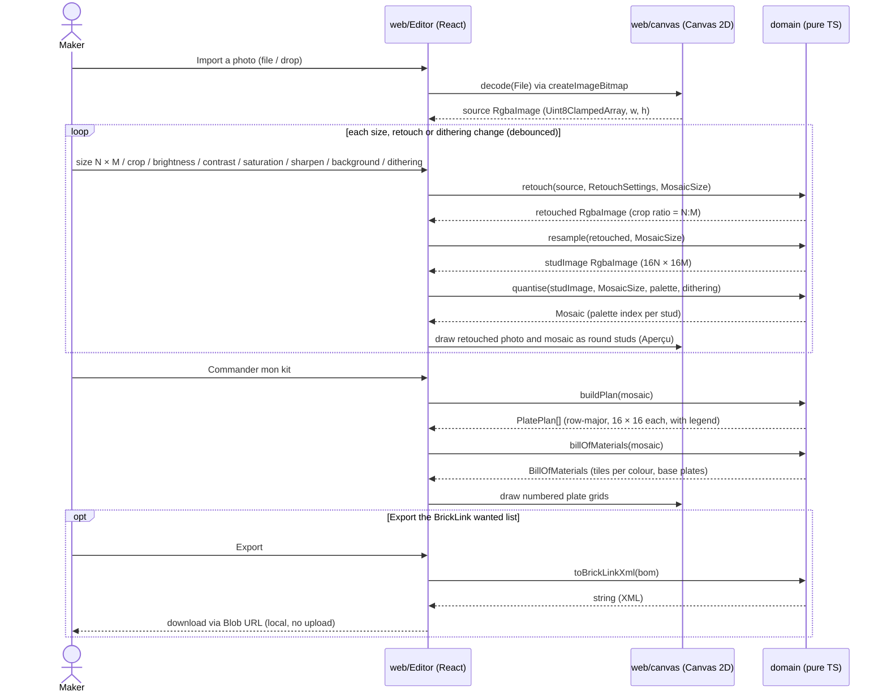

# sd Photo to kit

## Context

How a photo flows from import to the kit, across the web layer and the pure domain. Main success
scenario of the use cases in `01-use-case.md`.

## Diagram

## Notes

- Decoding and drawing are the only Canvas steps; every computation is a pure domain function over
  typed arrays, so it is unit-testable without a DOM.
- Retouch always restarts from the decoded source, never from the previous result, so adjustments
  do not accumulate rounding loss. The crop rectangle is clamped to the `N:M` ratio of the size.
- Algorithms (V1 defaults, each a domain spec to detail before its code brick): colour distance
  CIEDE2000 in CIELAB; dithering Floyd–Steinberg; resampling by area average (box filter);
  sharpen by unsharp mask; background simplification by flattening low-detail regions toward
  their mean colour.
- If the live chain proves slow on a giant mosaic or a large photo, the same domain calls can move
  into a Web Worker without changing the domain (decision deferred until measured, owner
  2026-10-23).
