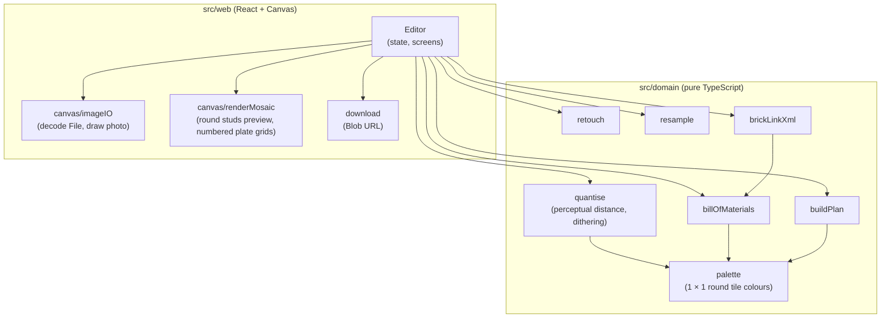

# cmp brickpix

## Context

Which modules exist and who depends on whom. The dependency rule: `domain` imports nothing (no
package, no DOM, no React); `web` depends on `domain`, never the reverse.

## Diagram

## Notes

- No network egress: there is no API client component. The only output leaving the page is a file
  the user downloads.
- The purity of `src/domain` is enforced by `tsconfig.domain.json` (no DOM lib) and the ESLint
  import rule set up in brick 1.
