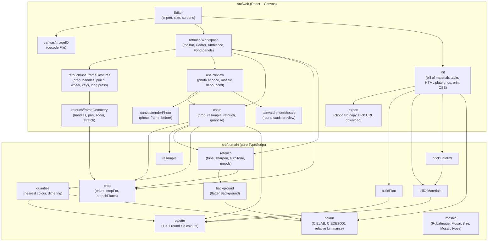

# cmp brickpix

## Context

Which modules exist and who depends on whom. The dependency rule: `domain` imports nothing (no
package, no DOM, no React); `web` depends on `domain`, never the reverse.

## Diagram

## Notes

- `mosaic` holds the shared domain types and size rules; every domain module may import it (arrows
  omitted for legibility). `crop` frames the source, `retouch` works on the stud grid
  ([retouch.md](../../specs/retouch.md)).
- No network egress: there is no API client component. Outputs leave the page only on the user's
  action: the printed plan, the BrickLink XML copied to the clipboard or downloaded as a file.
- The plan is an HTML/CSS grid, not a canvas (spec [kit.md](../../specs/kit.md)): vector print,
  testable in the DOM, light on memory for 8 × 8 plates.
- The purity of `src/domain` is enforced by `tsconfig.domain.json` (no DOM lib) and the ESLint
  import rule set up in brick 1.
