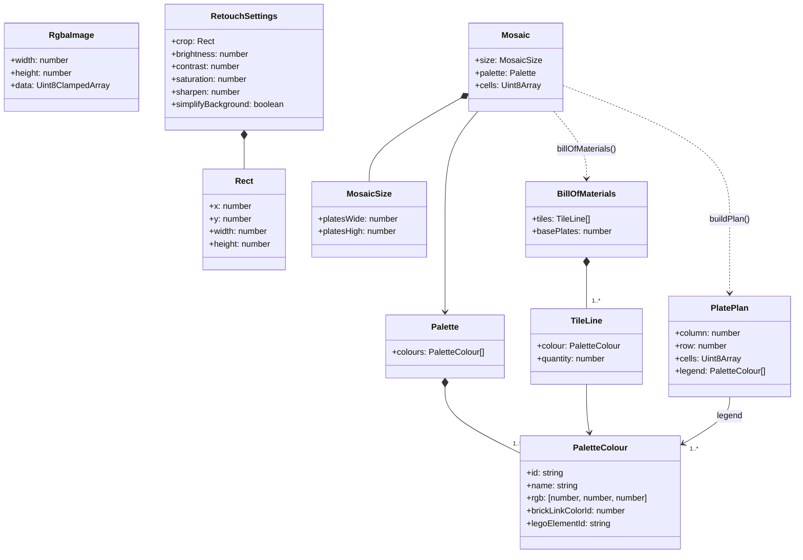

# cd Mosaic domain

## Context

Domain types of `src/domain`. Plain data plus pure functions; no classes are required at
implementation, the diagram states the shapes and relations.

## Diagram

## Notes

- `MosaicSize` counts base plates; studs are `16 × plates`. Both counts are integers ≥ 1.
- `Mosaic.cells` holds one palette index per stud, row-major (`studsWide × studsHigh`).
- `RetouchSettings.crop` keeps the `platesWide:platesHigh` ratio of the current size.
- `PlatePlan.cells` is the 16 × 16 slice of one plate; plates are numbered row-major from the top
  left, which is the build order. `legend` lists the colours used on that plate, in palette order;
  the plan grid prints each stud's legend number.
- `BillOfMaterials.basePlates = platesWide × platesHigh`; tile quantities are exact counts (spares
  are the buyer's choice, not added silently).
- The palette is a static data table in the domain; exact colour values live in
  [the palette spec](../../specs/palette-round-tiles.md), not this diagram.
