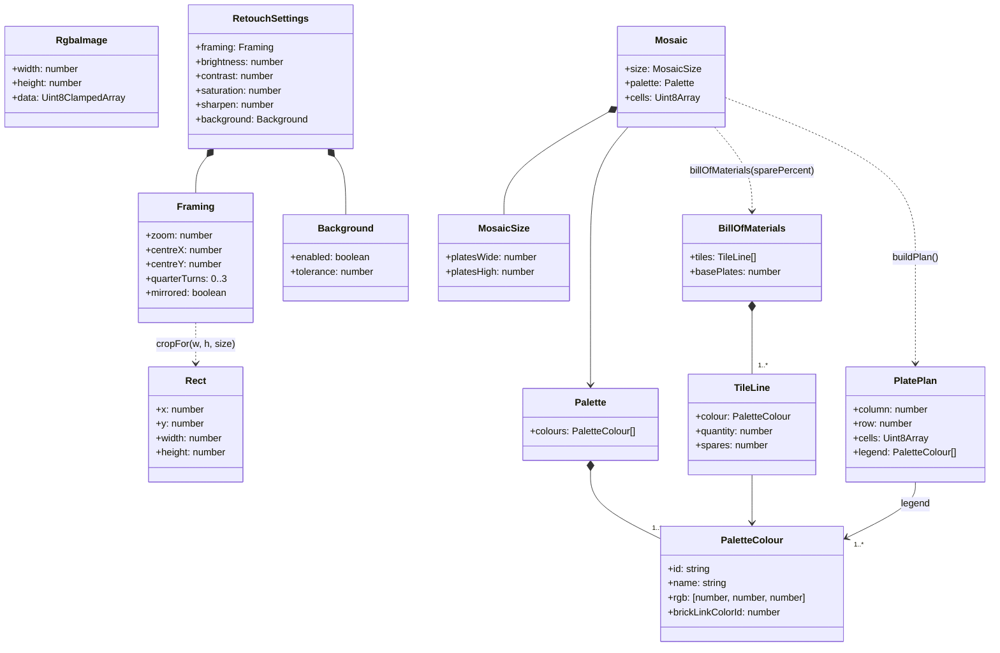

# cd Mosaic domain

## Context

Domain types of `src/domain`. Plain data plus pure functions; no classes are required at
implementation, the diagram states the shapes and relations.

## Diagram

## Notes

- `MosaicSize` counts base plates; studs are `16 × plates`. Both counts are integers ≥ 1.
- `Mosaic.cells` holds one palette index per stud, row-major (`studsWide × studsHigh`).
- `cropFor` returns a `Rect` with the `platesWide:platesHigh` ratio of the current size; ranges and
  formulas of every setting live in [retouch.md](../../specs/retouch.md).
- `PlatePlan.cells` is the 16 × 16 slice of one plate; plates are numbered row-major from the top
  left, which is the build order. `legend` lists the colours used on that plate, in palette order;
  the plan grid prints each stud's legend number.
- `BillOfMaterials.basePlates = platesWide × platesHigh`; `quantity` is the exact count of tiles to
  place; `spares = ceil(quantity × sparePercent / 100)` with `sparePercent` in 0, 2, 5: visible and
  adjustable by the buyer, 2 % by default ([kit.md](../../specs/kit.md)).
- The palette is a static data table in the domain; exact colour values live in
  [the palette spec](../../specs/palette-round-tiles.md), not this diagram.
