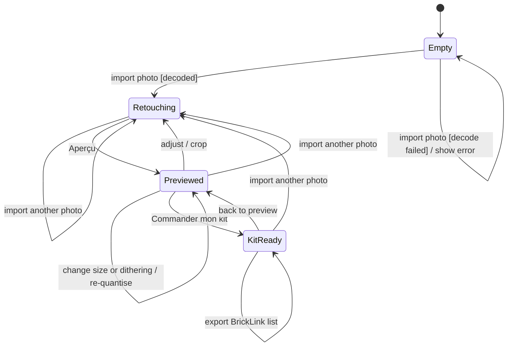

# stm Editor

## Context

Lifecycle of the editor in `src/web`. Nothing is persisted: reloading the page returns to `Empty`.

## Diagram

## Notes

- Importing another photo always restarts retouching from the new source; settings reset.
- The kit is derived from the current mosaic; going back invalidates it.
