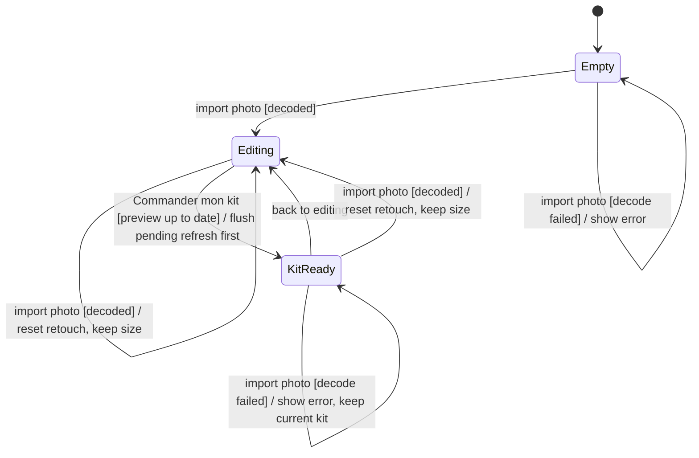

# stm Editor

## Context

Lifecycle of the editor in `src/web`. Nothing is persisted: reloading the page returns to `Empty`.

## Diagram

## Notes

- `Editing` always shows the live preview («Aperçu») of the current photo, size and settings.
- A new photo resets the retouch settings but keeps the chosen size (the gift's wall space does not
  change with the photo).
- «Commander mon kit» first flushes and awaits any debounced refresh, so the kit always matches
  the current inputs, never a stale mosaic.
- The kit is derived from the current mosaic; going back to editing discards it.
