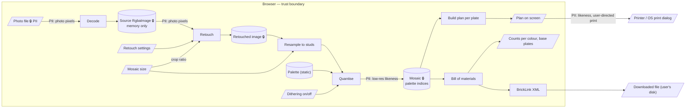

# Data flow — pixels in, tiles and lists out

## Context

What data flows where, and which of it is sensitive. The photo is personal data (faces, places):
it and every image derived from it stay in browser memory.

## Diagram

## Notes

- 🔒 and `PII:` edges mark data derived from the photo. None of it crosses the browser boundary except the printed plan below:
  no upload, no storage, no analytics on image content.
- Printing the plan is the one user-directed egress of photo-derived data (the plan pictures the
  mosaic): it goes to the OS print dialog, outside the browser boundary, only on the user's action.
- The BrickLink XML holds only part ids, colour ids and quantities; it leaves the browser only as
  a file the user chooses to download.
- The mosaic itself is a low-resolution rendition of the photo; it is treated as sensitive too.
